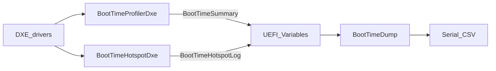

# x86 UEFI Boot-Time Measurement

EDK II／OVMF 上的開機時間量測與 A/B 比較工具。本倉庫是 **overlay**（只含本專案新增與修改的檔案），需合併到可建置的完整 `edk2` 才能編譯並用 QEMU 執行。

本專案可：在 DXE／BDS 記錄開機各段耗時與耗時項目、輸出 CSV、重複開機統計，並比較兩組建置的差異是否大於組內變異。  
本專案不能據此宣稱「開機已加速若干％」；定稿實驗只驗證量測流程與 PCD 開關。

---

## 流程

1. `BootTimeProfilerDxe` 在 EndOfDxe、ReadyToBoot、ExitBootServices 讀取效能計數器，把各段耗時寫入 UEFI 變數 `BootTimeSummary`。  
2. `BootTimeHotspotDxe` 在 ReadyToBoot 依 PCD 決定是否收集耗時項目，寫入 `BootTimeHotspotLog`。  
3. `BootTimeDump` 讀取上述變數，由序列埠輸出 CSV。  
4. `run_benchmark.ps1` 建置 OVMF（可選）、用 QEMU TCG 開機、擷取序列埠並算統計。  
5. 兩組建置只差在 Policy／Hotspot 兩個 PCD；`compare_ab.ps1` 比較統計結果。

資料路徑：兩個 DXE driver → `SetVariable`（NVRAM）→ Dump `GetVariable` → 序列埠 CSV → 主機腳本。  
結構定義：`edk2/BootTimeOptPkg/Include/Guid/BootTimeOptPkgVariable.h`。

---

## 模組

開機順序：SEC → PEI → DXE → BDS → ExitBootServices。本專案作用在 **DXE／BDS**。

| 模組 | 類型 | 時機 | 輸出 |
|---|---|---|---|
| `BootTimeProfilerDxe` | DXE driver | EndOfDxe、ReadyToBoot、ExitBootServices | `BootTimeSummary` |
| `BootTimeHotspotDxe` | DXE driver | ReadyToBoot（受 PCD 控制） | `BootTimeHotspotLog` |
| `BootTimeDump` | UEFI application | 被載入為開機映像時 | 序列埠 CSV |



`BootTimeSummary.Reserved0` 用位元標記各事件是否發生。時間為 0 且旗標為 0 代表事件未發生，不是耗時極短。

測試把 `BootTimeDump.efi` 當成 `EFI\BOOT\BOOTX64.EFI`，印完 CSV 即返回開機選單，**不呼叫 `ExitBootServices`**，故 EBS 相關時間與旗標預期為 0。

### PCD

| PCD | 用途 |
|---|---|
| `PcdBootTimeOptEnablePolicy` | 與 Hotspot 同時為 TRUE 才收集耗時項目 |
| `PcdBootTimeOptEnableHotspot` | 耗時項目收集開關 |

- `-Mode baseline` → 兩者 FALSE  
- `-Mode optimized` → 兩者 TRUE  

CSV 的 `PolicyEnabled`／`HotspotEnabled` 對應建置時的 PCD。  
有 `PerformanceEx` 紀錄時優先使用；否則改記階段耗時（定稿實驗多為 `PHASE / EndOfDxe->ReadyToBoot`）。  
`optimized` 只表示「開啟收集的那一組」，不表示開機路徑已改快。

---

## 倉庫內容

```text
edk2/
  BootTimeOptPkg/
    BootTimeProfilerDxe/
    BootTimeHotspotDxe/
    BootTimeDump/
    Include/Guid/
    tools/                 # run_benchmark.ps1、compare_ab.ps1
    docs/AB_Results.md
  OvmfPkg/
    OvmfPkgX64.dsc
    OvmfPkgX64.fdf
```

---

## 環境

| 項目 | 說明 |
|---|---|
| 完整 edk2 | 可 `edksetup`、`build` |
| 工具鏈 | 預設 VS2022 |
| NASM／iASL | 設定 `NASM_PREFIX`、`IASL_PREFIX` |
| QEMU | 預設 `C:\Program Files\qemu\qemu-system-x86_64.exe` |
| Python | BaseTools（例如 `py -3`） |

路徑有空白時，改用無空白路徑，或 `subst` 成單字母磁碟再當 `-Edk2Root`。

---

## 操作

1. 取得完整 `edk2`，覆寫本 overlay 的 `BootTimeOptPkg` 與修改過的 `OvmfPkg`。  
2. Baseline：

```powershell
.\BootTimeOptPkg\tools\run_benchmark.ps1 `
  -Edk2Root <完整edk2路徑> `
  -Mode baseline `
  -BuildFirmware `
  -Runs 10 `
  -BootTimeoutSec 90
```

3. Optimized：同上，改 `-Mode optimized`。  
4. 比較：

```powershell
.\BootTimeOptPkg\tools\compare_ab.ps1 `
  -BaselineStatsCsv <...>\baseline_stats.csv `
  -OptimizedStatsCsv <...>\optimized_stats.csv `
  -OutputDir <輸出資料夾>
```

腳本會（可選）建 OVMF、把 Dump 放到 `QemuFs\EFI\BOOT\BOOTX64.EFI`、QEMU 開機擷取 CSV，收齊 Summary、耗時項目列（或 `hotspot,error`）與 `last_successful_bootoption` 後計算 Mean／Median／P95／Min／Max。

輸出目錄：`BootTimeOptPkg\results\<mode>-<時間戳>\`。

---

## 結果

| 欄位 | 意義 |
|---|---|
| `EntryToEndOfDxeNs` | Profiler 載入到 EndOfDxe |
| `EndOfDxeToReadyToBootNs` | EndOfDxe 到 ReadyToBoot（主指標） |
| `ReadyToBootToExitBootServicesNs`／`EntryToExitBootServicesNs` | 本測試預期為 0 |
| `*Reached` | 該事件是否發生 |
| `PolicyEnabled`／`HotspotEnabled` | 建置 PCD |
| `rank,...` | 有收集時的耗時項目列；baseline 常為 `hotspot,error` |

主指標判定（見 [`docs/AB_Results.md`](edk2/BootTimeOptPkg/docs/AB_Results.md)）：

`|Median_opt − Median_base| > (Max_base − Min_base) / 2`

未通過則不得宣稱開機加速成功。

### 定稿（2026-11-06，每組 10 次）

目錄：`baseline-20261106-230720`、`optimized-20261106-230757`、`ab-20261106-policy-hotspot`。

| Metric | Baseline Mean (ns) | Optimized Mean (ns) | Delta (ns) | 差異 (%) |
|---|---:|---:|---:|---:|
| EntryToEndOfDxeNs | 268235263.9 | 250411574.1 | -17823689.8 | 6.64 |
| EndOfDxeToReadyToBootNs | 668041552.2 | 684719063 | 16677510.8 | -2.5 |
| ReadyToBootToExitBootServicesNs | 0 | 0 | 0 | 0 |
| EntryToExitBootServicesNs | 0 | 0 | 0 | 0 |

- baseline：`PolicyEnabled=0, HotspotEnabled=0`；optimized：`1,1`  
- 主指標 Median 差約 31 ms，門檻約 39 ms → **未通過**  
- 結論：量測流程可用；開啟耗時項目收集的額外時間無法與重複變異分開

---

## 限制

1. QEMU TCG 受宿主機負載影響，不宜跨機或跨日比絕對奈秒。  
2. 未進入作業系統，EBS 相關欄位為 0。  
3. 耗時項目常為階段時間，不是每個驅動的詳細排名。  
4. optimized 組多做的是收集工作；要驗證真實加速，需另改開機路徑後再用同一腳本與門檻驗證。
