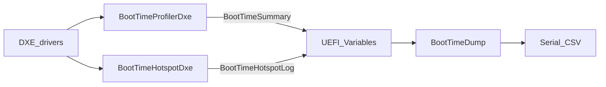

# x86 UEFI Boot-Time Measurement

基於 EDK II／OVMF 之開機延遲量測與效能 A/B 基準評測套件。本專案採 Overlay（差分覆蓋）架構，僅收錄新增與變更之模組與設定檔；使用前須將內容覆蓋（整合）至完整的 EDK II 原始碼根目錄中，方可進行建置並透過 QEMU 模擬執行。

本專案可在 DXE／BDS 記錄開機各段耗時與耗時項目、輸出 CSV、重複開機統計，並比較兩組建置的差異。另提供互動式 `BootTimeDashboard` 查看量測與系統／記憶體資訊。  
本專案**沒有**實作開機加速策略；`optimized`／Policy 僅為量測開關命名。

---

## 流程

1. `BootTimeProfilerDxe` 在 EndOfDxe、ReadyToBoot、ExitBootServices 讀取效能計數器，把各段耗時寫入 UEFI 變數 `BootTimeSummary`。  
2. `BootTimeHotspotDxe` 在 ReadyToBoot 依 PCD 決定是否收集耗時項目，寫入 `BootTimeHotspotLog`。  
3. **自動測試**：`BootTimeDump` 讀取變數並印 CSV，接著呼叫 `ExitBootServices`；Profiler 在回呼中更新 NVRAM，並用序列埠補上最終 EBS 欄位。  
4. `run_benchmark.ps1`／`compare_ab.ps1` 重複開機並比較統計。  
5. **互動查看**：從 UEFI Shell 執行 `BootTimeDashboard.efi`（不呼叫 `ExitBootServices`）。

資料路徑（自動測試）：兩個 DXE driver → `SetVariable`（NVRAM）→ Dump `GetVariable`／印 CSV → `ExitBootServices` → Profiler 補 EBS CSV → 主機腳本。  
結構定義：`edk2/BootTimeOptPkg/Include/Guid/BootTimeOptPkgVariable.h`。

---

## 模組

開機順序：SEC → PEI → DXE → BDS → ExitBootServices。本專案作用在 **DXE／BDS**。

| 模組 | 類型 | 時機 | 輸出 |
|---|---|---|---|
| `BootTimeProfilerDxe` | DXE driver | EndOfDxe、ReadyToBoot、ExitBootServices | `BootTimeSummary` |
| `BootTimeHotspotDxe` | DXE driver | ReadyToBoot（受 PCD 控制） | `BootTimeHotspotLog` |
| `BootTimeDump` | UEFI application | 自動測試 BOOTX64 | 序列埠 CSV（會呼叫 EBS） |
| `BootTimeDashboard` | UEFI application | Shell 手動執行 | 文字選單（不呼叫 EBS） |



`BootTimeSummary.Reserved0` 用位元標記各事件是否發生。時間為 0 且旗標為 0 代表事件未發生，不是耗時極短。

測試把 `BootTimeDump.efi` 當成 `EFI\BOOT\BOOTX64.EFI`。Dump 先印 CSV，再呼叫 `ExitBootServices`；Profiler 以序列埠補上最終 EBS 欄位。成功時 `ExitBootServicesReached` 應為 1，兩段 EBS 時間應為非 0。Dump 不載入作業系統，EBS 成功後停在死迴圈。

### PCD

| PCD | 用途 |
|---|---|
| `PcdBootTimeOptEnablePolicy` | 與 Hotspot 同時為 TRUE 才收集耗時項目 |
| `PcdBootTimeOptEnableHotspot` | 耗時項目收集開關 |

- `-Mode baseline` → 兩者 FALSE  
- `-Mode optimized` → 兩者 TRUE  

CSV 的 `PolicyEnabled`／`HotspotEnabled` 對應建置時的 PCD。  
有 `PerformanceEx` 紀錄時優先使用；否則改記階段耗時（定稿實驗多為 `PHASE / EndOfDxe->ReadyToBoot`）。  
`optimized` 只表示「開啟收集的那一組」，不表示開機路徑已改快。

---

## 專案內容

```text
edk2/
  BootTimeOptPkg/
    BootTimeProfilerDxe/
    BootTimeHotspotDxe/
    BootTimeDump/
    BootTimeDashboard/     # 互動儀表板（選單／SMBIOS／Memory Map）
    Include/Guid/
    tools/                 # run_benchmark.ps1、compare_ab.ps1
    docs/AB_Results.md
  OvmfPkg/
    OvmfPkgX64.dsc
    OvmfPkgX64.fdf
```

---

## 兩種執行方式

| 用途 | 程式 | 說明 |
|---|---|---|
| 自動測試 | `BootTimeDump.efi` | `run_benchmark.ps1` 設為 `BOOTX64.EFI`；印 CSV 後呼叫 EBS；停留時間不應混入量測流程 |
| 互動查看 | `BootTimeDashboard.efi` | 在 UEFI Shell 執行；方向鍵／Enter／Esc；**不**呼叫 EBS；在選單停留會拉長 ReadyToBoot→EBS（若之後再測） |

Dashboard 選單：

1. Boot-Time Measurements（讀 `BootTimeSummary`／`BootTimeHotspotLog`；未發生事件顯示 Not reached；標示 NVRAM 可能來自前次開機）  
2. System Information（韌體／RTC／SMBIOS；QEMU 上為虛擬機資訊）  
3. Memory Map（執行當下的 GetMemoryMap 快照）  
4. Exit  

UI／SMBIOS／Memory Map 邏輯參考 [FirmwareDashboardPkg](https://github.com/weijhih0403/FirmwareDashboardPkg)，來源說明見 `BootTimeDashboard/NOTICE`。

---

## 環境

| 項目 | 說明 |
|---|---|
| 完整 edk2 | 可 `edksetup`、`build` |
| 工具鏈 | 預設 VS2022 |
| NASM／iASL | 設定 `NASM_PREFIX`、`IASL_PREFIX` |
| QEMU | 預設 `C:\Program Files\qemu\qemu-system-x86_64.exe` |
| Python | BaseTools（例如 `py -3`） |

路徑有空白時，改用無空白路徑，或 `subst` 成單字母磁碟再當 `-Edk2Root`。

---

## 操作

### 建置

覆寫 overlay 後以完整 edk2 建 OVMF（與既有流程相同）。產物包含：

- `Build\OvmfX64\<TARGET>_<TOOLCHAIN>\X64\BootTimeDump.efi`  
- `Build\OvmfX64\<TARGET>_<TOOLCHAIN>\X64\BootTimeDashboard.efi`  

### 啟動 Dashboard（互動）

1. 將 `BootTimeDashboard.efi` 放到 ESP／`QemuFs`（例如 `EFI\BOOT\` 旁或工具目錄）。  
2. 開機進入 **UEFI Shell**（不要用 Dump 當唯一 BOOTX64）。  
3. 執行：`BootTimeDashboard.efi`  
4. 以 Up／Down／Enter／Esc 操作；長頁面可用 PgUp／PgDn。

### 自動測試（不變）

1. 取得完整 `edk2`，覆寫本 overlay 的 `BootTimeOptPkg` 與修改過的 `OvmfPkg`。  
2. Baseline：

```powershell
.\BootTimeOptPkg\tools\run_benchmark.ps1 `
  -Edk2Root <完整edk2路徑> `
  -Mode baseline `
  -BuildFirmware `
  -Runs 10 `
  -BootTimeoutSec 90
```

3. Optimized：同上，改 `-Mode optimized`。  
4. 比較：

```powershell
.\BootTimeOptPkg\tools\compare_ab.ps1 `
  -BaselineStatsCsv <...>\baseline_stats.csv `
  -OptimizedStatsCsv <...>\optimized_stats.csv `
  -OutputDir <輸出資料夾>
```

腳本會（可選）建 OVMF、把 Dump 放到 `QemuFs\EFI\BOOT\BOOTX64.EFI`、QEMU 開機擷取 CSV，收齊 Summary、`ExitBootServicesReached=1`、耗時項目列（或 `hotspot,error`）與 `last_successful_bootoption` 後計算 Mean／Median／P95／Min／Max。

輸出目錄：`BootTimeOptPkg\results\<mode>-<時間戳>\`。

---

## 結果

| 欄位 | 意義 |
|---|---|
| `EntryToEndOfDxeNs` | Profiler 載入到 EndOfDxe |
| `EndOfDxeToReadyToBootNs` | EndOfDxe 到 ReadyToBoot（主指標） |
| `ReadyToBootToExitBootServicesNs`／`EntryToExitBootServicesNs` | ReadyToBoot／Entry 到 ExitBootServices（Dump 呼叫 EBS 後應非 0） |
| `*Reached` | 該事件是否發生；成功跑完時 `ExitBootServicesReached` 應為 1 |
| `PolicyEnabled`／`HotspotEnabled` | 建置 PCD |
| `rank,...` | 有收集時的耗時項目列；baseline 常為 `hotspot,error` |

完整統計見 [`docs/AB_Results.md`](edk2/BootTimeOptPkg/docs/AB_Results.md)。

### 定稿（2026-11-07，每組 10 次）

目錄：`baseline-20261107-214115`、`optimized-20261107-214243`、`ab-20261107-ebs-policy-hotspot`。

| Metric | Baseline Mean (ns) | Optimized Mean (ns) | Delta (ns) | 差異 (%) |
|---|---:|---:|---:|---:|
| EntryToEndOfDxeNs | 255428357.1 | 247158535 | -8269822.1 | 3.24 |
| EndOfDxeToReadyToBootNs | 718433375.7 | 676939191.5 | -41494184.2 | 5.78 |
| ReadyToBootToExitBootServicesNs | 553985743.6 | 568442441.1 | 14456697.5 | -2.61 |
| EntryToExitBootServicesNs | 1527847477.3 | 1492540168.6 | -35307308.7 | 2.31 |

- baseline：`PolicyEnabled=0, HotspotEnabled=0`；optimized：`1,1`；全部 `ExitBootServicesReached=1`  
- `EndOfDxeToReadyToBootNs` Median：baseline `713717385` ns，optimized `677491831.5` ns（差約 36.2 ms）  
- baseline 同組 Max−Min：`93864443` ns（約 93.9 ms）

---

## 限制

1. QEMU TCG 受宿主機負載影響，不宜跨機或跨日比絕對奈秒。  
2. `BootTimeDump` 會呼叫 `ExitBootServices`，但不載入作業系統；`BootTimeDashboard` 不呼叫 EBS。  
3. 耗時項目常為階段 fallback，不是每個驅動的詳細排名。  
4. NVRAM 量測紀錄可能來自前次開機；Dashboard 會標示此限制。  
5. optimized／Policy 只控制收集開關，不代表已完成開機加速。
