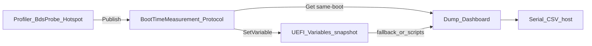

# x86 UEFI Boot-Time Measurement

在 EDK II／OVMF 上量測 UEFI 韌體開機時間。本專案只保留新增或修改的程式碼，使用前需要整合至完整的 EDK II 專案，再以 QEMU 建置與執行。

**這個專案在做什麼：** 在 DXE／BDS 階段記錄各段開機時間、輸出 CSV、重複開機做統計，並可用文字選單查看結果。

---

## 為什麼要做

UEFI 開機流程大致是：SEC → PEI → DXE → BDS → ExitBootServices。  
若只看整段總時間，很難知道時間花在哪一段。本專案先把 DXE／BDS 拆成幾個可對照的區間，再在 BDS 裡把連線裝置、刷新開機選項等步驟分開記錄，方便分析時間花在哪裡，不會直接縮短開機時間。

---

## 實際完成了什麼

1. 記錄 DXE／BDS 主要事件之間的時間（EndOfDxe、ReadyToBoot、ExitBootServices）。  
2. 在 BDS 階段記錄連線裝置、刷新開機選項等步驟的開始與結束時間。  
3. 提供 `BootTimeMeasurement` Protocol：同開機內的量測服務（Publish／Get）；NVRAM 仍作快照給腳本。  
4. 自動測試時輸出 CSV，並可重複開機後比較兩組設定。  
5. 提供互動式 `BootTimeDashboard`，優先經 Protocol 查看本次開機量測。

---

## 怎麼運作

1. `BootTimeProfilerDxe` 安裝 `BootTimeMeasurement` Protocol，在 EndOfDxe／ReadyToBoot／ExitBootServices 更新 Summary（記憶體即時副本 + NVRAM 快照）。  
2. `BootTimeBdsProbeLib` 在連線裝置、刷新開機選項等檢查點經 Protocol `PublishBdsBreakdown`（找不到 Protocol 才直接寫 Variable）；Profiler／Dump 同樣經服務補 ReadyToBoot／LoadPath。  
3. `BootTimeHotspotDxe` 在 ReadyToBoot 依設定收集較長項目，經 Protocol `PublishHotspotLog`。  
4. **自動測試**：`BootTimeDump` 優先 `LocateProtocol` 讀即時資料印 CSV，找不到再讀 Variable；接著 `ExitBootServices`，Profiler 以序列埠補最終欄位。  
5. `run_benchmark.ps1`／`compare_ab.ps1` 重複開機並比較統計。  
6. **互動查看**：`BootTimeDashboard.efi` 優先 Protocol（頁面會標 `source=Protocol`），否則 NVRAM 備援。

資料路徑：寫端 → **Protocol（同開機服務）** → 順便 NVRAM 快照 → Dump／Dashboard／主機腳本。  
介面：`Include/Protocol/BootTimeMeasurement.h`；結構：`Include/Guid/BootTimeOptPkgVariable.h`。

---

## 模組

開機順序：SEC → PEI → DXE → BDS → ExitBootServices。本專案作用在 **DXE／BDS**。

| 模組 | 類型 | 時機 | 輸出 |
|---|---|---|---|
| `BootTimeProfilerDxe` | DXE 驅動程式 | 安裝 Protocol；EndOfDxe／RTB／EBS | Protocol + `BootTimeSummary` |
| `BootTimeBdsProbeLib` | Library（BDS） | 連線／刷新／RTB／Dump 進入 | Protocol + `BootTimeBdsBreakdown` |
| `BootTimeHotspotDxe` | DXE 驅動程式 | ReadyToBoot（受 PCD 控制） | Protocol + `BootTimeHotspotLog` |
| `BootTimeDump` | UEFI 應用程式 | 自動測試 BOOTX64 | 優先 Protocol，CSV＋ExitBootServices |
| `BootTimeDashboard` | UEFI 應用程式 | Shell 手動執行 | 優先 Protocol 文字選單 |

### BDS 階段再細分（EndOfDxe → ReadyToBoot）

OVMF 在 `PlatformBootManagerBeforeConsole` 內才送出 EndOfDxe。此區間再拆成：

| CSV 欄位 | 意義 |
|---|---|
| `bds,PreConnectNs` | EndOfDxe → 開始連線裝置（含 AfterConsole 前段） |
| `bds,ConnectAllNs` | `PlatformBdsConnectSequence`／ConnectAll |
| `bds,RefreshBootOptionsNs` | `EfiBootManagerRefreshAllBootOption` |
| `bds,PostRefreshToReadyToBootNs` | 刷新開機選項結束 → ReadyToBoot 事件 |
| `bds,LoadPathNs` | ReadyToBoot → Dump 進入（約 LoadImage／StartImage；屬 ReadyToBoot→ExitBootServices，不計入下面四個階段） |

四個階段的時間加總應接近 `EndOfDxeToReadyToBootNs`（允許小誤差）。這些數字用來分析時間花在哪裡，不會直接縮短開機時間。



`BootTimeSummary.Reserved0` 用位元標記各事件是否發生。時間為 0 且旗標為 0 代表事件未發生，不是時間極短。

測試把 `BootTimeDump.efi` 當成 `EFI\BOOT\BOOTX64.EFI`。Dump 先印 CSV，再呼叫 `ExitBootServices`；Profiler 以序列埠補上最終欄位。成功時 `ExitBootServicesReached` 應為 1，相關時間應為非 0。Dump 不載入作業系統；ExitBootServices 成功後，程式會持續停留在迴圈中，不繼續啟動作業系統。

### 兩組設定（PCD）

| PCD | 用途 |
|---|---|
| `PcdBootTimeOptEnablePolicy` | 與 Hotspot 同時為 TRUE 才收集執行時間較長的項目 |
| `PcdBootTimeOptEnableHotspot` | 是否啟用上述收集 |

- `-Mode baseline` → 兩者 FALSE（較少額外紀錄）  
- `-Mode optimized` → 兩者 TRUE（啟用額外效能紀錄）

CSV 的 `PolicyEnabled`／`HotspotEnabled` 對應建置時的 PCD。  
若有 `PerformanceEx` 詳細紀錄會優先使用；否則改用階段時間作為分析依據（本次測試結果多為 `PHASE / EndOfDxe->ReadyToBoot`）。  
請注意：`optimized` 只表示「開啟額外紀錄的那一組」，**不是**「已經改過開機流程、完成加速」的意思。

---

## 專案內容

```text
edk2/
  BootTimeOptPkg/
    BootTimeProfilerDxe/
    BootTimeHotspotDxe/
    BootTimeDump/
    BootTimeDashboard/     # 互動選單（SMBIOS／Memory Map）
    Library/BootTimeBdsProbeLib/
    Include/Guid/
    Include/Library/
    tools/                 # run_benchmark.ps1、compare_ab.ps1
    # docs/ 僅本機，不進 GitHub
  OvmfPkg/
    Library/PlatformBootManagerLib/  # BDS 時間記錄
    OvmfPkgX64.dsc
    OvmfPkgX64.fdf
```

---

## 兩種執行方式

| 用途 | 程式 | 說明 |
|---|---|---|
| 自動測試 | `BootTimeDump.efi` | `run_benchmark.ps1` 設為 `BOOTX64.EFI`；印 CSV 後呼叫 ExitBootServices |
| 互動查看 | `BootTimeDashboard.efi` | 在 UEFI Shell 執行；方向鍵／Enter／Esc；**不**呼叫 ExitBootServices |

Dashboard 選單：

1. Boot-Time Measurements（讀 `BootTimeSummary`／`BootTimeHotspotLog`；未發生的事件顯示 Not reached；並提醒 NVRAM 可能來自前次開機）  
2. System Information（韌體／RTC／SMBIOS；QEMU 上為虛擬機資訊）  
3. Memory Map（執行當下的 GetMemoryMap 快照）  
4. Exit  

UI／SMBIOS／Memory Map 邏輯參考 [FirmwareDashboardPkg](https://github.com/weijhih0403/FirmwareDashboardPkg)，來源說明見 `BootTimeDashboard/NOTICE`。

---

## 環境

| 項目 | 說明 |
|---|---|
| 完整 edk2 | 可執行 `edksetup`、`build` |
| 工具鏈 | 預設 VS2022 |
| NASM／iASL | 設定 `NASM_PREFIX`、`IASL_PREFIX` |
| QEMU | 預設 `C:\Program Files\qemu\qemu-system-x86_64.exe` |
| Python | BaseTools（例如 `py -3`） |

路徑有空白時，改用無空白路徑，或 `subst` 成單字母磁碟再當 `-Edk2Root`。

---

## 操作

### 建置

把本專案內容整合到完整 edk2 後建 OVMF。產物包含：

- `Build\OvmfX64\<TARGET>_<TOOLCHAIN>\X64\BootTimeDump.efi`  
- `Build\OvmfX64\<TARGET>_<TOOLCHAIN>\X64\BootTimeDashboard.efi`  

### 啟動 Dashboard（互動）

1. 將 `BootTimeDashboard.efi` 放到 ESP／`QemuFs`。  
2. 開機進入 **UEFI Shell**（不要只用 Dump 當 BOOTX64）。  
3. 執行：`BootTimeDashboard.efi`  
4. 以 Up／Down／Enter／Esc 操作；長頁面可用 PgUp／PgDn。

### 自動測試

1. 取得完整 `edk2`，覆寫本專案的 `BootTimeOptPkg` 與修改過的 `OvmfPkg`。  
2. 第一組（較少額外紀錄）：

```powershell
.\BootTimeOptPkg\tools\run_benchmark.ps1 `
  -Edk2Root <完整edk2路徑> `
  -Mode baseline `
  -BuildFirmware `
  -Runs 10 `
  -BootTimeoutSec 90
```

3. 第二組（啟用額外效能紀錄）：同上，改 `-Mode optimized`。  
4. 比較：

```powershell
.\BootTimeOptPkg\tools\compare_ab.ps1 `
  -BaselineStatsCsv <...>\baseline_stats.csv `
  -OptimizedStatsCsv <...>\optimized_stats.csv `
  -OutputDir <輸出資料夾>
```

腳本會（可選）建 OVMF、把 Dump 放到 `QemuFs\EFI\BOOT\BOOTX64.EFI`、用 QEMU 開機擷取 CSV，收齊 Summary、`ExitBootServicesReached=1`、執行時間較長項目的列（或 `hotspot,error`）與 `last_successful_bootoption` 後計算 Mean／Median／P95／Min／Max。

輸出目錄：`BootTimeOptPkg\results\<mode>-<時間戳>\`。

---

## 結果怎麼讀

| 欄位 | 意義 |
|---|---|
| `EntryToEndOfDxeNs` | Profiler 載入到 EndOfDxe |
| `EndOfDxeToReadyToBootNs` | EndOfDxe 到 ReadyToBoot（主要觀察區間） |
| `ReadyToBootToExitBootServicesNs`／`EntryToExitBootServicesNs` | ReadyToBoot／Entry 到 ExitBootServices（Dump 呼叫後應非 0） |
| `*Reached` | 該事件是否發生；成功跑完時 `ExitBootServicesReached` 應為 1 |
| `PolicyEnabled`／`HotspotEnabled` | 建置時的 PCD |
| `rank,...` | 有收集時的項目列；baseline 常為 `hotspot,error` |

更細的本地紀錄（若有）在 `edk2/BootTimeOptPkg/docs/`（此目錄不推送到 GitHub）。

### 本次測試結果（2026-11-17，每組 10 次，含 Protocol）

目錄：`baseline-20261117-233118`、`optimized-20261117-233009`、`ab-20261117-protocol`。

| 測量區間 | Baseline 平均 | Optimized 平均 | 差值 |
|---|---:|---:|---:|
| EndOfDxe → ReadyToBoot | 639.79 ms | 656.88 ms | +17.09 ms |
| Driver 入口 → ExitBootServices | 1,432.01 ms | 1,473.40 ms | +41.39 ms |

啟用額外效能紀錄的那一組，本次測得時間略高，符合「多做紀錄有成本」；**不是**開機加速。Protocol 改進的是同開機內的資料介面。

補充：

- baseline：`PolicyEnabled=0, HotspotEnabled=0`；optimized：`1,1`  
- optimized 有 HotspotRank1（約 643 ms，多為階段備援）  
- BDS 細分中 PreConnect 仍最大（約 399–401 ms）

---

## 限制

1. QEMU TCG 會受執行 QEMU 的電腦目前使用情況影響，不宜跨機或跨日直接比絕對時間。  
2. `BootTimeDump` 會呼叫 `ExitBootServices`，但不載入作業系統；`BootTimeDashboard` 不呼叫 ExitBootServices。  
3. 執行時間較長的項目紀錄，常常是無法取得詳細紀錄時改用階段時間作為分析依據，不是每個驅動程式的詳細排名。  
4. Dashboard／Dump 優先 Protocol（本次開機）；NVRAM 備援可能來自前次開機。  
5. `optimized`／Policy 只控制是否啟用額外紀錄，不代表已完成開機加速。  
6. ExitBootServices 之後不可再用 LocateProtocol；最終腳本仍依 Variable／序列埠 CSV。
