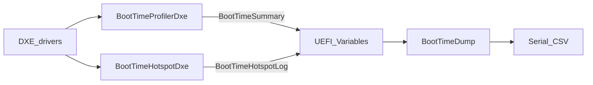

# x86 UEFI Boot-Time Optimizer

<<<<<<< HEAD
加在 EDK II / OVMF 上的**開機時間量測與驗證框架**（overlay，需疊進完整 EDK II 才能編譯）。  
目標是先能量測、能量複、能判斷差異是否超過誤差。
=======
加在 EDK II / OVMF 上的**開機時間量測與驗證框架**。  
本倉庫是 **overlay**（只含與本專案相關的修改），需疊進一份完整的 `edk2` 樹才能編譯與跑 QEMU。
>>>>>>> 00aecd8 (Rewrite README with full concepts and ops, and sync AB_Results summary.)

**本專案能做的事**：在 DXE 階段打點、記錄熱點、用 CSV 匯出、用腳本重複開機並做 A/B 比較，判斷差異是否大於重複誤差。  
**本專案不是**：已證明「開機變快 X%」的優化成品。目前定稿實驗驗證的是量測鏈路與開關行為，不是某條開機路徑已被加速。

---

## 概念：開機階段與三個模組

UEFI 開機可粗分成 SEC → PEI → DXE → BDS →（進入 OS 前的 ExitBootServices）。  
本專案主要作用在 **DXE / BDS**：

| 模組 | 類型 | 時機 | 產出 |
|---|---|---|---|
| `BootTimeProfilerDxe` | DXE driver | EndOfDxe / ReadyToBoot / ExitBootServices | NVRAM 變數 `BootTimeSummary` |
| `BootTimeHotspotDxe` | DXE driver | ReadyToBoot（受 PCD 開關） | NVRAM 變數 `BootTimeHotspotLog` |
| `BootTimeDump` | UEFI application | 被選為開機映像時 | 序列埠 CSV |

共同資料格式定義在 `edk2/BootTimeOptPkg/Include/Guid/BootTimeOptPkgVariable.h`。  
Profiler / Hotspot 用 `SetVariable` 寫入；Dump 用 `GetVariable` 讀出。這塊儲存是 UEFI 變數（NVRAM；在 OVMF 上常對應 `OVMF_VARS.fd`）。



### 階段旗標與「時間為 0」

`BootTimeSummary.Reserved0` 用位元表示階段是否真的發生過（例如 `EndOfDxeReached`）。  
**旗標為 0 且時間為 0**＝這段沒走到，不能解讀成「這段很快」。  
本倉庫的自動測試把 `BootTimeDump.efi` 當成 `EFI\BOOT\BOOTX64.EFI`，印完 CSV 就回開機選單，**不會呼叫 `ExitBootServices`**，因此與 EBS 相關的欄位預期為 0。

### 建置開關（PCD）

| PCD | 意義 |
|---|---|
| `PcdBootTimeOptEnablePolicy` | A/B 臂開關（須與 Hotspot 一併打開才收集） |
| `PcdBootTimeOptEnableHotspot` | 熱點收集細部開關 |

**兩者同時為 TRUE** 時，`BootTimeHotspotDxe` 才會在 ReadyToBoot 收集並寫入熱點 log。  
`run_benchmark.ps1` 約定：

- `-Mode baseline` → Policy=FALSE、Hotspot=FALSE  
- `-Mode optimized` → Policy=TRUE、Hotspot=TRUE  

CSV 中的 `PolicyEnabled` / `HotspotEnabled` 對應這兩個 PCD 的建置值。

熱點優先讀 `PerformanceEx` gauge；若平台沒有可用 gauge，則改記階段時間備援（目前 OVMF/QEMU 實驗多為 `PHASE / EndOfDxe->ReadyToBoot`）。

---

## 倉庫裡有什麼

```text
edk2/
  BootTimeOptPkg/          # 本專案套件
    BootTimeProfilerDxe/
    BootTimeHotspotDxe/
    BootTimeDump/
    Include/Guid/          # 變數與結構定義
    tools/                 # run_benchmark.ps1, compare_ab.ps1
    docs/AB_Results.md     # 定稿實驗紀錄（僅一組）
  OvmfPkg/
    OvmfPkgX64.dsc         # 接入 BootTimeOptPkg 與效能庫設定
    OvmfPkgX64.fdf         # 把模組放進韌體映像
```

把上述路徑合併／覆蓋到你的完整 EDK II 工作區後再建置。

---

## 環境前提

| 項目 | 說明 |
|---|---|
| 完整 edk2 | 含 BaseTools，可 `edksetup` + `build` |
| 工具鏈 | 例如 VS2022（與腳本預設 `Toolchain=VS2022` 一致） |
| NASM | 設定 `NASM_PREFIX` |
| iASL | 設定 `IASL_PREFIX`（編 OVMF ACPI 相關時需要） |
| QEMU | 腳本預設 `C:\Program Files\qemu\qemu-system-x86_64.exe` |
| Python | EDK II BaseTools 使用（例如 `py -3`） |

**路徑含空白**（例如資料夾名有空格）時，直接把未加引號的路徑傳給 QEMU / `cmd` 容易失敗。可用無空白的工作路徑，或先 `subst` 成單字母磁碟再當 `-Edk2Root`。

---

## 操作流程

### 1. 準備完整樹

1. 取得一份可建置的完整 `edk2`。  
2. 將本 overlay 的 `BootTimeOptPkg` 與修改過的 `OvmfPkg` 檔案拷入對應位置。  
3. 確認 QEMU、NASM、iASL、VS 開發人員命令環境可用。

### 2. 跑 baseline（關閉熱點收集）

在完整 edk2 根目錄（或 `subst` 後的根）執行：

```powershell
.\BootTimeOptPkg\tools\run_benchmark.ps1 `
  -Edk2Root <完整edk2路徑> `
  -Mode baseline `
  -BuildFirmware `
  -Runs 10 `
  -BootTimeoutSec 90
```

- `-BuildFirmware`：依 Mode 帶入 PCD 後建 OVMF。  
- 輸出目錄形如：`BootTimeOptPkg\results\baseline-<時間戳>\`  
  - `raw\serial_XX.log`、`raw\run_XX.csv`  
  - `baseline_runs.csv`、`baseline_stats.csv`

### 3. 跑 optimized（開啟 Policy + Hotspot）

```powershell
.\BootTimeOptPkg\tools\run_benchmark.ps1 `
  -Edk2Root <完整edk2路徑> `
  -Mode optimized `
  -BuildFirmware `
  -Runs 10
```

輸出在 `BootTimeOptPkg\results\optimized-<時間戳>\`。

若韌體已用正確 PCD 建好，可省略 `-BuildFirmware`，腳本只跑 QEMU 量測。

### 4. 比較兩臂

```powershell
.\BootTimeOptPkg\tools\compare_ab.ps1 `
  -BaselineStatsCsv <...>\baseline_stats.csv `
  -OptimizedStatsCsv <...>\optimized_stats.csv `
  -OutputDir <輸出資料夾>
```

會產生 `ab_comparison.csv` / `ab_comparison.md`。

### 5. 腳本在做什麼（摘要）

1. （可選）建置 OVMF。  
2. 將 `BootTimeDump.efi` 拷到 `QemuFs\EFI\BOOT\BOOTX64.EFI`。  
3. 用 QEMU TCG 開機，序列埠擷取 CSV。  
4. 等到 Summary 與（熱點列或 `hotspot,error`）以及 `last_successful_bootoption` 齊全才算一次成功。  
5. 彙總 Mean / Median / P95 / Min / Max（僅對時間欄位；旗標不當成奈秒統計）。

---

## 如何解讀結果

### CSV 常見欄位

| 欄位 | 意義 |
|---|---|
| `EntryToEndOfDxeNs` | 從 Profiler 載入到 EndOfDxe |
| `EndOfDxeToReadyToBootNs` | EndOfDxe → ReadyToBoot（主觀察段之一） |
| `ReadyToBootToExitBootServicesNs` / `EntryToExitBootServicesNs` | 本測試設計下預期為 0 |
| `*Reached` | 該階段事件是否發生 |
| `PolicyEnabled` / `HotspotEnabled` | 建置時 PCD |
| 熱點 `rank,...` | 有收集時的 Top-N；baseline 常為 `hotspot,error`（無 log） |

### 判定差異是否「可量測」

定稿實驗預先規定（見 `docs/AB_Results.md`）：

對主指標 `EndOfDxeToReadyToBootNs`，僅當  

`|Median_opt − Median_base| > (Max_base − Min_base) / 2`  

才稱為超過 baseline 組內雜訊門檻。否則差異視為與 TCG／宿主機波動無法分開，**不得**說成開機優化成功。

### 定稿實驗（僅此一組）

日期 **2026-11-06**，各 10 次。詳見 [edk2/BootTimeOptPkg/docs/AB_Results.md](edk2/BootTimeOptPkg/docs/AB_Results.md)。  
資料目錄：`baseline-20261106-230720`、`optimized-20261106-230757`、`ab-20261106-policy-hotspot`。

| Metric | Baseline Mean (ns) | Optimized Mean (ns) | Delta (ns) | 差異 (%) |
|---|---:|---:|---:|---:|
| EntryToEndOfDxeNs | 268235263.9 | 250411574.1 | -17823689.8 | 6.64 |
| EndOfDxeToReadyToBootNs | 668041552.2 | 684719063 | 16677510.8 | -2.5 |
| ReadyToBootToExitBootServicesNs | 0 | 0 | 0 | 0 |
| EntryToExitBootServicesNs | 0 | 0 | 0 | 0 |

- 旗標：baseline 皆 `PolicyEnabled=0, HotspotEnabled=0`；optimized 皆 `1,1`。  
- 主指標 Median 差約 31 ms，門檻約 39 ms → **未通過**雜訊門檻。  
- 結論：量測與 A/B 流程可運作；在此 TCG 環境下，打開熱點收集的開銷無法與重複誤差清楚分開。

---

## 已知限制

1. **QEMU TCG**：時間跟宿主機 CPU／負載有關，跨機器、跨日的絕對奈秒不要直接比。  
2. **未進入 OS**：EBS 相關指標為 0 是測試設計使然。  
3. **熱點常為階段備援**：不是逐驅動 gauge 排名。  
4. **optimized 臂多做的是收集工作**：用來驗證開關與量測開銷，不是預設就代表「已優化開機路徑」。若要做真正優化，需另改具體 boot 路徑，再以同一套腳本與門檻驗證。

---

## 相關檔案

- 套件與變數：`edk2/BootTimeOptPkg/`  
- 量測腳本：`edk2/BootTimeOptPkg/tools/run_benchmark.ps1`  
- 比較腳本：`edk2/BootTimeOptPkg/tools/compare_ab.ps1`  
- 定稿結果：`edk2/BootTimeOptPkg/docs/AB_Results.md`
